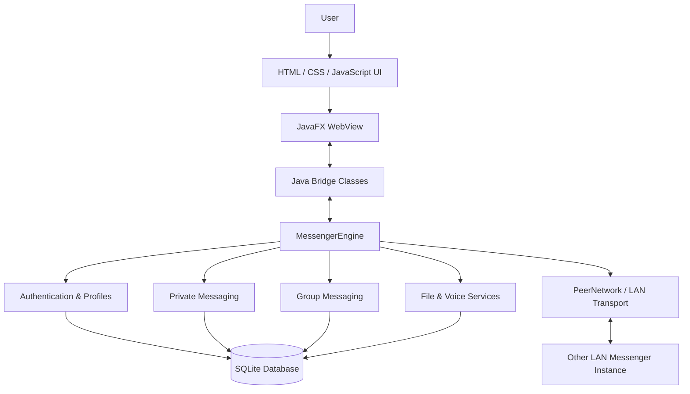
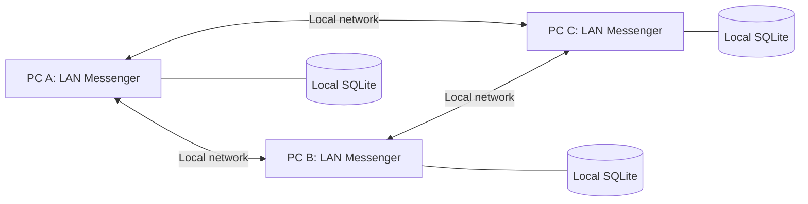
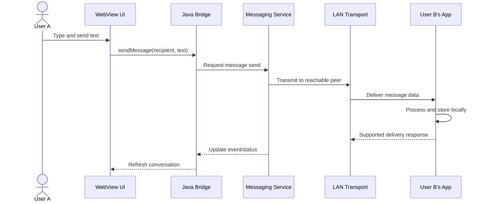

<div align="center">

# LAN Messenger

### Local Network Messaging Application Using Java

**Private Chat · Group Chat · File Sharing · Voice Messages · Local Data Storage**


**A software development project**

[**Download Windows Installer**](https://github.com/Vickyvishu2312/LAN-Messenger/releases) · [**Source Code**](https://github.com/Vickyvishu2312/LAN-Messenger) · [**Report a Bug**](https://github.com/Vickyvishu2312/LAN-Messenger/issues)

</div>

---

## Table of Contents

1. [Project Overview](#1-project-overview)
2. [Abstract](#2-abstract)
3. [Problem Statement](#3-problem-statement)
4. [Objectives and Scope](#4-objectives-and-scope)
5. [Features](#5-features)
6. [Technology Stack](#6-technology-stack)
7. [System Architecture](#7-system-architecture)
8. [How LAN Messenger Works](#8-how-lan-messenger-works)
9. [Modules and Implementation](#9-modules-and-implementation)
10. [Database Design](#10-database-design)
11. [Requirements and Use Cases](#11-requirements-and-use-cases)
12. [Repository Folder Structure](#12-repository-folder-structure)
13. [Download and Installation](#13-download-and-installation)
14. [Build and Run from Source](#14-build-and-run-from-source)
15. [Testing and Verification](#15-testing-and-verification)
16. [Screenshots and Demo](#16-screenshots-and-demo)
17. [Team Members and Contributions](#17-team-members-and-contributions)
18. [Academic Documents and Important Links](#18-academic-documents-and-important-links)
19. [Development Process and Milestones](#19-development-process-and-milestones)
20. [Limitations and Future Scope](#20-limitations-and-future-scope)
21. [Security, Privacy, and Troubleshooting](#21-security-privacy-and-troubleshooting)
22. [Contributing, License, and Credits](#22-contributing-license-and-credits)

---

## 1. Project Overview

| Field | Details |
|---|---|
| **Project title** | Design and Development of a Local Area Network-Based Messenger Using Java |
| **Application name** | LAN Messenger |
| **Project category** | Desktop Application / Computer Networks / Software Engineering |
| **Type** | LAN-based peer-to-peer-style desktop messenger |
| **Primary platform** | Windows x64 |
| **Current packaged version** | v1.0.4 |
| **Core language** | Java |
| **Frontend** | JavaFX WebView, HTML, CSS, JavaScript |
| **Database** | SQLite, accessed through JDBC |
| **Communication** | Java sockets over a Local Area Network |
| **Team** | Pushpendra Rathore , Yogesh Saini, Vikash , Chirag Jangra and Udai Singh |
| **Development period** | July–October 2026 |
| **Repository** | [Vickyvishu2312/LAN-Messenger](https://github.com/Vickyvishu2312/LAN-Messenger) |
| **Maintainer** | Vikash |

**LAN Messenger** is a Windows desktop application that lets people using computers on the **same Local Area Network (LAN)** communicate without depending on a public internet messaging service. It provides private conversations, groups, file transfers, voice notes, local chat history, and desktop alerts through a modern messaging interface.

Each running copy of the application operates on its own computer. Java implements communication and storage; JavaFX WebView renders an interface built with web technologies. A centralized public chat server is not required for normal LAN communication.

### Intended users

- College and school computer laboratories.
- Small offices and teams on the same internal network.
- Homes, classrooms, and local training centers.
- Developers studying socket programming, JavaFX, SQLite, or modular Java design.

### Project motivation

Two computers might already share a Wi-Fi network or Ethernet switch even when internet connectivity is slow, unreliable, restricted, or unavailable. LAN Messenger makes use of that existing local connectivity to exchange information directly between reachable devices.

---

## 2. Abstract

LAN Messenger is a Java-based desktop messaging system developed to support communication among users connected to a common Local Area Network. Conventional cloud messaging applications usually depend on external internet services, making them less suitable for some offline laboratories or restricted internal networks. The proposed system focuses on local communication through Java socket programming and a modular software design.

Its graphical interface combines JavaFX WebView with HTML, CSS, and JavaScript. Java backend services manage user authentication, peer discovery, private and group communication, attachments, voice messages, and notifications. SQLite provides persistent local storage for relevant user and conversation information. A Java-to-JavaScript bridge connects interface actions to the backend and updates the interface when network events occur.

The application is distributed as a Windows installer using `jpackage` with a bundled Java runtime. The project demonstrates how networking, desktop user interfaces, database persistence, asynchronous event handling, and software packaging can be integrated into a practical desktop system. Actual reliability, latency, and security claims must be supported by separate test results.

---

## 3. Problem Statement

### 3.1 Existing problem

Many commonly used chat applications depend on the internet and centrally hosted services. In a classroom, laboratory, or office where several computers are already connected to one LAN, using an external messaging service may be unnecessary or impractical. Other informal approaches—such as passing USB drives, manually copying files, or sharing information verbally—can slow down communication.

### 3.2 Proposed solution

> **Design and implement a modular Windows desktop application that enables users on the same Local Area Network to discover reachable peers and exchange text messages, group messages, files, and voice notes, while maintaining local conversation records, without requiring a public internet-based messaging server.**

### 3.3 Key challenges addressed

| Challenge | Approach in LAN Messenger |
|---|---|
| Internet dependency | LAN-based communication among reachable peers |
| Discovering other users | Local peer discovery and contact synchronization |
| Real-time message exchange | Java socket communication and asynchronous events |
| Remembering earlier chats | Persistent local storage with SQLite |
| Multiple participants | Dedicated group messaging module |
| Sharing richer content | File attachments and recorded voice messages |
| Usable desktop experience | JavaFX WebView interface with HTML/CSS/JavaScript |
| Windows distribution | Installable EXE with a packaged Java runtime |

---

## 4. Objectives and Scope

### 4.1 Objectives

1. Build a working desktop communication application for a local network.
2. Provide registration, login, and user profile handling.
3. Discover and show available users on the LAN.
4. Implement one-to-one text conversations and group chats.
5. Save and retrieve relevant conversation history locally.
6. Add file attachments and recorded voice messages.
7. Support message management, notifications, and multiple UI themes.
8. Organize the code into independently maintainable software modules.
9. Produce a Windows installer that bundles the required Java runtime.
10. Document architecture, requirements, design decisions, and testing.

### 4.2 In scope

LAN discovery, local peer communication, local account management, conversations, groups, supported attachments, audio notes, SQLite persistence, desktop UI, and Windows x64 packaging.

### 4.3 Out of scope

Internet-wide messaging, hosted cloud synchronization, browser-only hosting, guaranteed cross-platform deployment, and enterprise-grade security certifications are **not** claimed as part of this release.

---

## 5. Features

| Area | Feature | Description |
|---|---|---|
| Account | Registration and login | Create and use a local application account |
| Profiles | Avatar and profile information | View or update supported account/profile details |
| Discovery | LAN contacts | Identify other reachable application users |
| Private chat | Text messaging | Exchange messages with an individual contact |
| History | Persistent conversations | Retrieve previously stored messages |
| Message actions | Delete and clear | Delete a message locally or for everyone where supported; clear conversations |
| Delivery | Message status | Display available message status information |
| Groups | Group conversations | Create groups and communicate with multiple members |
| Group management | Roles and membership | Maintain group member information and supported owner/admin actions |
| File sharing | Attachments | Choose and send supported files to a contact |
| Group attachments | Group file sharing | Share supported files with eligible reachable group members |
| Voice notes | Record and play | Send short recorded audio through the messaging workflow |
| Notifications | Desktop notifications | Display supported incoming-message/file notifications |
| Sound | Native alert tones | Separate message/notification sounds and a mute control |
| Appearance | Themes | Change interface themes and visual preferences |
| Distribution | Windows installer | Install a packaged application without separately installing Java |

**Important delivery distinction:** Private and group text workflows include local persistence/queue-related logic. Attachment behavior is separate; group file sharing can require all intended members to be online. Do not describe all file transfers as guaranteed offline deliveries.

---

## 6. Technology Stack

| Layer / purpose | Technology | Why it was selected |
|---|---|---|
| Main programming language | **Java** | Object-oriented design, networking, concurrency, desktop libraries |
| Application window | **JavaFX** | Desktop lifecycle, WebView, event integration |
| Graphical interface | **HTML + CSS** | Flexible layouts, themes, reusable visual components |
| Frontend behavior | **JavaScript** | Interactive chat controls, events, dynamic message rendering |
| Frontend-backend bridge | **JavaFX WebEngine / JSObject** | Connects browser-style UI logic with Java application services |
| Network transport | **Java TCP/IP sockets** | Device-to-device communication over a local network |
| Peer/contact management | **Java LAN discovery services** | Finds and tracks reachable participants |
| Database | **SQLite + JDBC** | Embedded local database without a separate DB server |
| Audio | **Java Sound API** | Microphone recording, playback, notification tones |
| Desktop alerts | **Java AWT SystemTray** | Integrates notification messages with Windows |
| Packaging | **JDK `jpackage`** | Creates Windows application images/installers |
| Installer tooling | **WiX Toolset** | Windows installation packaging support |
| Source management | **Git + GitHub** | Version history, collaboration, releases, documentation |

The current product uses **JavaFX WebView** for its final frontend; Java Swing was explored earlier in development but should not be described as the final chat screen framework.

---

## 7. System Architecture

### 7.1 High-level component diagram



### 7.2 Network topology



This diagram represents **direct LAN communication** between application instances, not a single cloud-hosted chat server. Each machine maintains its own local data. Actual reachability depends on network and firewall settings.

### 7.3 Layered architecture

| Layer | Main responsibilities | Example classes/files |
|---|---|---|
| Presentation | Render screens, clicks, message bubbles, themes | `index.html`, `app.js`, `groups.js`, CSS |
| Java bridge | Pass UI requests to Java and emit UI updates | `WebBridge`, `GroupWebBridge`, `VoiceWebBridge` |
| Application controller | Coordinate sessions and application services | `MessengerEngine` |
| Business services | Authentication, messages, groups, files, profiles | `AuthService`, `MessagingService`, `GroupService` |
| Network | Discover peers, connect, transfer protocol messages | `PeerNetwork`, related transport classes |
| Persistence | Database setup and repositories | `DatabaseManager`, `GroupRepository`, other repositories |
| Desktop integration | Window, logo, alerts and audio | `WebMain`, `DesktopNotifier`, `NativeSounds` |

### 7.4 Why the architecture is modular

Private chats, group chats, voice recording, file sharing, notifications, and UI-related functionality have distinct components. This reduces coupling and makes it easier to modify or test one optional feature without rewriting the entire application. The core private messaging path is kept separate from optional group and voice UI bridges.

---

## 8. How LAN Messenger Works

### 8.1 Step-by-step explanation for beginners

**Step 1 — Start the application.** The user launches LAN Messenger from the Start menu or desktop shortcut. `WebMain` starts the JavaFX desktop application, creates the WebView, and loads `index.html` and associated frontend resources.

**Step 2 — Initialize local services.** `MessengerEngine` coordinates the backend. `DatabaseManager` prepares access to the local SQLite storage. The frontend communicates with Java via bridge objects exposed to the page.

**Step 3 — Register or sign in.** The user enters account credentials. The interface calls Java bridge methods, which invoke authentication services. The active user profile is established before networking begins.

**Step 4 — Discover LAN peers.** The networking service starts, identifies other reachable instances on the local network, and updates the contact list. On isolated or blocked networks, discovery can fail even if Wi-Fi is connected.

**Step 5 — Open a chat.** Selecting a contact requests stored conversation history and displays the selected chat in the interface.

**Step 6 — Send a message.** JavaScript passes the text and recipient to `WebBridge`. The bridge calls `MessengerEngine`, which delegates to `MessagingService` and the network layer. The message is then transmitted to the reachable recipient through the LAN.

**Step 7 — Receive a message.** The receiving instance processes the incoming data, updates its local state/storage, and notifies its UI. Message bubbles and supported alerts are displayed.

**Step 8 — Continue later.** Stored messages can be shown again after restarting the application. Some pending communication events can be retried when a peer becomes reachable, depending on the feature and service implementation.

### 8.2 Private message sequence



### 8.3 Group messaging

A user creates a group and selects available participants. The group service maintains a group identity and roster and authorizes operations according to supported group roles. Sending a group message queues or distributes events to relevant members. Each member's application maintains local group information and message history. Group creation and role management are implemented separately from private chat.

### 8.4 Sending files

A user presses **Attach**, selects a file, and initiates a LAN transfer. The file service processes transfer activity and the interface displays attachment information. Group sharing follows a separate workflow and may require the selected group members to be online. Received files are stored locally according to the application's file-handling rules.

### 8.5 Voice messages

The user presses the microphone button, records a short message, and sends the recorded audio through the attachment workflow. Java audio services handle recording/playback while JavaScript manages the controls and frontend representation. WAV-based recording is used in the current implementation.

### 8.6 Notifications and themes

Incoming events can trigger a Windows desktop notification or a native audio tone. The sound toggle can mute or unmute these tones. Themes and other supported UI preferences are handled through the frontend and local preference storage.

### 8.7 Why internet access is not required

Devices communicate over their **local IP network**. They do not have to send every message through a cloud endpoint. However, LAN connectivity, reachable peer ports, suitable firewall settings, and absence of Wi-Fi client isolation are still required.

---

## 9. Modules and Implementation

| Module | Representative source components | Responsibilities |
|---|---|---|
| Startup and desktop shell | `WebMain.java` | Start JavaFX, load WebView, manage the window and icon |
| Application coordination | `MessengerEngine.java` | Authentication/session flow and backend service coordination |
| Authentication | `AuthService.java` | Registration, login, profile/session validation |
| Peer discovery and transport | `PeerNetwork.java`, `PeerInfo.java` | Locate reachable peers and handle LAN transport |
| User profiles | `ProfileSyncService.java` | Contact and profile updates |
| Private messaging | `MessagingService.java` | Send/receive messages, history and status operations |
| Group messaging | `GroupService.java`, `GroupRepository.java` | Group membership, messaging and persistence |
| Attachments and files | `FileTransferService.java`, `AttachmentRepository.java` | File-transfer logic and attachment records |
| Voice messages | `VoiceMessageService.java`, `VoiceWebBridge.java` | Recording, playback and frontend controls |
| JavaScript communication | `WebBridge.java`, `GroupWebBridge.java` | Expose Java functionality to the HTML/JS interface |
| Database | `DatabaseManager.java`, repositories | SQLite connection, table initialization and CRUD operations |
| Notification sounds | `NativeSounds.java`, `native-sounds.js` | Play and control native sound events |
| Windows alerts | `DesktopNotifier.java` | Desktop/system tray notifications |
| Frontend | `index.html`, `app.js`, `groups.js`, `voice-messages.js`, CSS | Display and manage UI components |
| Packaging | `jpackage`, WiX build steps | Produce a branded Windows installer |

**Note:** The table gives representative classes discussed during development. Consult the latest source tree for the authoritative list, especially after future refactoring.

---

## 10. Database Design

SQLite is an embedded database: no separate MySQL/PostgreSQL server is needed. Records are stored locally on each computer, and the Java backend accesses them through JDBC.

### 10.1 Conceptual data entities

| Entity | Main information | Usage |
|---|---|---|
| User | User ID, username, credential-related data, profile information | Authentication and identity |
| Contact | Peer identity, username, availability, profile information | LAN contact display |
| Private message | ID, sender, recipient, text, time, status, deletion information | Direct chat history |
| Group | ID, name, creator, creation time, revision | Group identity |
| Group member | Group and user IDs, role, joined time | Membership and permissions |
| Group message | ID, group ID, sender ID, text, timestamp | Group chat history |
| Attachment | ID, sender/recipient/context, file details and transfer state | File and voice transfer tracking |
| Pending event | Event/peer IDs and serialized data | Retry/queue support |

These are **conceptual fields**, not a complete statement of the actual private-message/user table schema. Use the Java repository definitions to produce a formal ER diagram with exact column names and data types.

### 10.2 Implemented group storage tables

The group repository creates tables including:

| Table | Purpose |
|---|---|
| `gc_groups` | Locally known groups |
| `gc_members` | Membership and role records |
| `gc_messages` | Group message history |
| `gc_hidden` | Locally hidden group messages |
| `gc_deletions` | Global deletion records |
| `gc_outbox` | Pending outgoing group events |

### 10.3 Data integrity considerations

- Use unique identifiers to distinguish accounts, groups, and messages.
- Track event ordering and group membership revisions.
- Persist required information before relying on it after restarts.
- Validate membership and permissions for group operations.
- Keep local database files and personal conversation data **out of public GitHub commits**.

---

## 11. Requirements and Use Cases

### 11.1 Main actors

| Actor | Description |
|---|---|
| Registered user | Logs in, chats, sends files, records voice messages |
| Group owner/administrator | Manages supported group settings and membership |
| Other LAN peer | Runs another instance and receives communication events |
| Windows operating system | Provides network, storage, audio, and notification facilities |

### 11.2 Functional requirements (SRS summary)

| ID | Requirement |
|---|---|
| FR-01 | The system shall provide registration and login functions. |
| FR-02 | The system shall start LAN communication for an authenticated session. |
| FR-03 | The system shall discover and display reachable LAN peers. |
| FR-04 | The system shall allow a user to open a private conversation. |
| FR-05 | The system shall send and receive supported text messages. |
| FR-06 | The system shall save and retrieve supported conversation history. |
| FR-07 | The system shall support applicable message management actions. |
| FR-08 | The system shall provide group creation, membership and group chat. |
| FR-09 | The system shall support transferring eligible files over the LAN. |
| FR-10 | The system shall support voice recording and playback. |
| FR-11 | The system shall display supported notifications and audio alerts. |
| FR-12 | The system shall let users choose available interface themes. |
| FR-13 | The system shall report appropriate errors when networking or transfers fail. |
| FR-14 | The system shall be distributable as a Windows desktop installer. |

### 11.3 Non-functional requirements

| Category | Goal / expectation |
|---|---|
| Usability | Clear navigation, readable conversations, understandable controls |
| Responsiveness | The interface should remain usable during network operations |
| Reliability | Handle disconnections and failed transfers without crashing |
| Maintainability | Keep optional modules isolated from core messaging |
| Data persistence | Retain supported local records across normal restarts |
| Portability | Run the packaged release on compatible Windows x64 machines |
| Security | Validate inputs and permissions; do not claim unverified encryption |
| Privacy | Store relevant data locally; avoid publishing private databases |
| Network dependency | Require LAN reachability, not public internet access |

### 11.4 Example use case: Send a private message

**Preconditions:** Sender is logged in; recipient is known; the messaging service is active.  
**Main flow:** Select contact → type message → press Send → Java bridge calls messaging service → LAN transport attempts delivery → recipient processes event → UI/history update.  
**Alternative flow:** If recipient is unavailable, the system uses applicable local status/error/queue behavior.  
**Postconditions:** The sender sees the relevant local message state; the recipient sees it when delivery succeeds.

---

## 12. Repository Folder Structure


```text
LAN-Messenger/
├── README.md
├── .gitignore
├── src/
│   └── main/
│       ├── java/
│       │   └── com/
│       │       └── lanmessenger/
│       │           ├── app/
│       │           │   └── MessengerEngine.java
│       │           ├── core/
│       │           │   ├── MessengerApi.java
│       │           │   └── MessengerEvents.java
│       │           ├── backend/
│       │           │   ├── auth/
│       │           │   │   └── AuthService.java
│       │           │   ├── peer/
│       │           │   │   └── PeerInfo.java
│       │           │   ├── transport/
│       │           │   │   └── PeerNetwork.java
│       │           │   └── service/
│       │           │       ├── messaging/
│       │           │       │   └── MessagingService.java
│       │           │       ├── profile/
│       │           │       │   └── ProfileSyncService.java
│       │           │       ├── groups/
│       │           │       │   └── GroupService.java
│       │           │       ├── files/
│       │           │       │   └── FileTransferService.java
│       │           │       ├── attachments/
│       │           │       └── voice/
│       │           │           └── VoiceMessageService.java
│       │           ├── database/
│       │           │   ├── DatabaseManager.java
│       │           │   └── repository/
│       │           │       └── groups/
│       │           │           └── GroupRepository.java
│       │           └── frontend/
│       │               └── web/
│       │                   ├── WebMain.java
│       │                   ├── WebBridge.java
│       │                   ├── GroupWebBridge.java
│       │                   ├── VoiceWebBridge.java
│       │                   ├── NativeSounds.java
│       │                   └── DesktopNotifier.java
│       └── resources/
│           └── web/
│               ├── index.html
│               ├── app.js
│               ├── groups.js
│               ├── voice-messages.js
│               ├── native-sounds.js
│               ├── logo.png
│               ├── logo.ico
│               └── [supporting styles/assets]
```

Folders such as `build/`, `dist/`, private databases, temporary logs, and local user data are generated locally and should not be committed as normal source artifacts.

---

## 13. Download and Installation

### 13.1 Download Windows release

**[Open GitHub Releases](https://github.com/Vickyvishu2312/LAN-Messenger/releases)**

1. Open the release labeled **v1.0.4** (when available).
2. Under **Assets**, download `LAN-Messenger-v1.0.4-Windows-x64-Setup.zip`.
3. Extract the ZIP file.
4. Run the included `LAN Messenger-1.0.4.exe` **installer**.
5. Follow the setup wizard and launch **LAN Messenger**.
6. Repeat on other Windows PCs connected to the same local network.


### 13.2 System requirements

| Requirement | Details |
|---|---|
| OS | Compatible Windows 10/11 x64 (target platform) |
| Networking | Same reachable LAN or an appropriately routed local network |
| Internet | Not required for normal LAN messaging |
| Runtime | Java runtime bundled with the Windows installer |
| Permissions | Suitable firewall allowances on private networks |
| Disk and memory | Sufficient for the installed application, database, and user attachments |

Exact minimum CPU/RAM specifications and OS compatibility require device testing; no unsupported minimum is asserted here.

### 13.3 After installing

- Connect all participating computers to the same Wi-Fi/Ethernet LAN.
- Start the application and create or sign in to accounts.
- Allow required application communication through Windows Firewall for **Private** networks.
- Check whether other users appear in the contacts list.
- Try a private message, then a group message, a file, and a voice note.

### 13.4 Installer ZIP versus portable ZIP

| Package | What it should contain |
|---|---|
| **Setup ZIP** | Windows setup EXE; extract and run the installer |
| **Portable application ZIP** | Entire app image, including launcher, `app/`, and `runtime/` folders |

Do **not** distribute just the application-image launcher `LAN Messenger.exe` without its supporting files and runtime.

---

## 14. Build and Run from Source

These are development-oriented Windows PowerShell commands. They assume the repository contains the necessary `lib/javafx` module JARs and other dependencies. Use a compatible JDK version for the JavaFX libraries included in the project.

### 14.1 Clone

```powershell
git clone https://github.com/Vickyvishu2312/LAN-Messenger.git
cd LAN-Messenger
```

### 14.2 Compile

```powershell
New-Item -ItemType Directory -Force "build\classes" | Out-Null

$sources = @(Get-ChildItem "src\main\java" -Recurse -File -Filter "*.java" |
    ForEach-Object { $_.FullName })

if ($sources.Count -eq 0) { throw "No Java source files found" }

& javac --module-path "lib\javafx" `
    --add-modules javafx.web,javafx.media `
    -encoding UTF-8 `
    -cp "lib/*" `
    -d "build\classes" $sources

if ($LASTEXITCODE -ne 0) { throw "Compilation failed" }

Copy-Item "src\main\resources\*" "build\classes\" -Recurse -Force
```

### 14.3 Run

```powershell
& java --module-path "lib\javafx" `
    --add-modules javafx.web,javafx.media `
    --enable-native-access=ALL-UNNAMED,javafx.graphics,javafx.media,javafx.web `
    -cp "build\classes;lib/*" `
    com.lanmessenger.frontend.web.WebMain
```

The application entry point is `com.lanmessenger.frontend.web.WebMain`.

### 14.4 Packaging overview

Windows packaging uses JDK `jpackage` with the application's compiled JAR, required dependencies, a JavaFX-capable runtime image, and a Windows `.ico` icon. WiX is used to produce the Windows installer.

The packaging process conceptually follows:

`Compile classes → Copy resources → Create JAR → Bundle dependencies/runtime → Build app image → Build Windows EXE installer → Test on target PC`

A successful installer build does **not** prove that the application works on every machine. Validate the generated executable and its networking features before publishing a release.

---

## 15. Testing and Verification

### 15.1 Suggested test matrix

| Test ID | Test scenario | Expected behavior | Result |
|---|---|---|---|
| T01 | Register a new user | Valid account created | Pass |
| T02 | Sign in with valid credentials | Chat interface opens | Pass |
| T03 | Sign in with invalid credentials | Meaningful error shown | Pass |
| T04 | Launch on two LAN PCs | Reachable contacts appear | Pass |
| T05 | Send private text | Other client receives it | Pass |
| T06 | Reopen a conversation | Stored history loads | Pass |
| T07 | Create a group | Selected group appears | Pass |
| T08 | Send group message | Relevant group members receive it | Pass |
| T09 | Send a supported file | Recipient obtains the attachment | Pass |
| T10 | Record and send voice note | Audio can be received/played | Pass |
| T11 | Receive a new message | Appropriate alert/sound occurs | Pass |
| T12 | Change interface theme | Selected theme is applied | Pass |
| T13 | Close and restart app | Persisted data remains available | Pass |
| T14 | Temporarily disconnect peer | Supported error/queue behavior occurs | Pass |
| T15 | Install packaged application | App opens without external Java setup | Pass |

**Testing status:** Development included successful launches of a packaged Windows app and work on multi-device messaging. A complete published test report with reproducible pass/fail evidence, measurements, and hardware configurations has not been included here. Fill the Result column only from actual tests.

### 15.2 Suggested performance measurements for a research paper

- Message transmission latency on a controlled LAN.
- Time required to discover a newly available peer.
- File-transfer completion time for different file sizes.
- Application startup time.
- CPU and RAM consumption during normal chat and file transfers.
- Behavior during peer disconnection and reconnection.

Measure results on real devices and include the network environment; do not invent numbers.

---

## 16. Screenshots and Demo

| Screenshot / Media | What to show | Link |
|---|---|---|
| Login and registration | Account entry screens | **https://drive.google.com/file/d/1Ry9MEMX29QHOJKM5R4t-_OvtKPvzjm--/view?usp=drive_link** |
| Main dashboard | Sidebar and conversation panel | **https://drive.google.com/file/d/1J0jNWVO1HJYiR-gABs4Y45uUdN3Dcxun/view?usp=sharing** |
| Private chat | Sent/received message bubbles | **https://drive.google.com/file/d/1JuHXT1Epk5_mP1sY7ezm3qCCvzPl2t-6/view?usp=drive_link** |
| Group chat | Group messages and member controls | **https://drive.google.com/file/d/1JeolJevPbqoVaMuyauwgHLU9OrbfzAoG/view?usp=sharing** |
| File sharing | Attachment card or received file | **https://drive.google.com/file/d/1JuHXT1Epk5_mP1sY7ezm3qCCvzPl2t-6/view?usp=sharing** |
| Voice messages | Microphone controls and audio message | **https://drive.google.com/file/d/1Pup_7pQCOkRI-i0INP4lG9obm13xcif1/view?usp=drive_link** |
| Themes | Comparison of available themes | **https://drive.google.com/file/d/1J0jNWVO1HJYiR-gABs4Y45uUdN3Dcxun/view?usp=sharing** |
| Windows installer | Installation wizard or shortcut | **https://github.com/Vickyvishu2312/LAN-Messenger/releases/download/v1.0.4/LAN-Messenger-v1.0.4-Windows-x64-Setup.zip** |
| Explaining/demo video | Full application walkthrough | **[video link]** |

**Screenshot checklist:** Hide personal conversations, passwords, private IP information where necessary, and any sensitive local files before publishing screenshots.

---

## 17. Team Members and Contributions


### 17.1 Team details

| Member | Name | Roll / Registration No. | Role | Work / Contribution |
|---|---|---|---|---|
| **Member 1** | **Pushpendra Rathore** | **24EARAD128** | **Project Coordination & Architecture** | Requirements analysis, module planning, architecture decisions, task coordination, system integration. |
| **Member 2** | **Yogesh Saini** | **24EARAD188** | **Backend & Networking** | Java application services, LAN discovery, peer connections, message transport, networking error handling. |
| **Member 3** | **Vikash** | **24EARAD178** | **Frontend Developer** | JavaFX WebView UI, HTML/CSS/JavaScript, login/chat layouts, responsive panels, theme styling, frontend controls, interface integration and improvements. |
| **Member 4** | **Chirag Jangra** | **25EARAD701** | **Database & Feature Integration** | SQLite repositories, local persistence, attachment/group/voice support, service integration. |
| **Member 5** | **Udai Singh** | **24EARAD166** | **Testing, Deployment & Documentation** | Test cases, regression checks, integration verification, Windows installer packaging, report/SRS/presentation support. |


### 17.2 Detailed responsibility guide

**Pushpendra Rathore — Project planning / architecture**

- Identify project scope, objectives, and requirements.
- Break the system into independently developable modules.
- Define interfaces and integration rules between modules.
- Coordinate task progress, reviews, and final project delivery.

**Yogesh Saini— Backend / LAN networking**

- Develop socket communication and peer discovery services.
- Implement core private-message sending and receiving.
- Handle session startup, background tasks, network errors, and peer availability.
- Support backend integration with UI events.

**Vikash — Frontend Development**

- Design login, registration, contact list, private chat, and group chat screens.
- Develop HTML, CSS, JavaScript UI within JavaFX WebView.
- Build message bubbles, timestamps, composer controls, and attachment displays.
- Implement navigation, user feedback, responsive layouts, and themes.
- Integrate frontend interactions with Java bridge methods and backend events.
- Improve voice note controls, notification toggle appearance, icons, and visual consistency.
- Participate in user-interface testing and bug fixing.

**Chirag Jangra — Database / extended features (editable assignment)**

- Design or maintain local database schemas and repositories.
- Support local user data, message history, and group persistence.
- Integrate attachments, voice message records, and related data flows.
- Check database reliability and data consistency during service updates.

**Udai Singh — QA / deployment / documentation**

- Prepare functional, integration, and installation test scenarios.
- Verify LAN messaging on multiple machines where available.
- Help resolve defects and prepare release notes.
- Assist in bundling the Java runtime, building the Windows EXE, and preparing academic deliverables.

### 17.3 Project guide / institute information

| Field | Value |
|---|---|
| College / Institute | **ARYA COLLEGE OF ENGINEERING AND INFORMATION TECHNOLOGY , JAIPUR** |
| Department | **Artificial Intelligence & Data Science** |
| Degree / Semester | **BTECH VTH SEM** |
| Project guide / mentor | **Er. RAM BABU BURI** |
| Academic session | **2024-28** |
| Team name / group number | **THE DICTATORS** |

---

## 18. Academic Documents and Important Links

### 18.1 Academic deliverables


| Deliverable | Description | Link / status |
|---|---|---|
| **Research Paper** | Problem, literature review, design approach, evaluation, references | **https://drive.google.com/drive/folders/1zoYEEwuZSE1kutqKcGY1x7CglgbeufoT?usp=drive_link** |
| **Project Report** | Full implementation report with modules, diagrams, screenshots and results | **https://drive.google.com/drive/folders/1hBS4j_ENO1vMSZW0VfDoqD2qRqoKd31b?usp=drive_link** |
| **SRS Document** | Software Requirements Specification: functional/non-functional requirements and use cases | **https://drive.google.com/drive/folders/1GIoAoEi-nbnx6AwZaprkLuNRcF8AwQBT?usp=drive_link** |
| **PPT / Presentation** | Project overview, architecture, demonstration, results and conclusion | **https://drive.google.com/drive/folders/1nIk-ZjqDdu2FQEWp2KRagSXTaR4Pd08X?usp=drive_link** |
| **Explaining Video** | Recorded end-to-end explanation and live demo | **[video link]** |
| **Demo Screenshots** | Visual evidence of implemented screens and features | **https://drive.google.com/drive/folders/1HJ0YZ0j-wRxpaudOkSUcTjH2awq84bsI?usp=drive_link** |

### 18.2 Development and release links

| Resource | URL |
|---|---|
| **GitHub repository** | https://github.com/Vickyvishu2312/LAN-Messenger |
| **Windows releases** | https://github.com/Vickyvishu2312/LAN-Messenger/releases |
| **Latest release page** | https://github.com/Vickyvishu2312/LAN-Messenger/releases/latest |
| **Issues / bug reports** | https://github.com/Vickyvishu2312/LAN-Messenger/issues |
| **Commit history** | https://github.com/Vickyvishu2312/LAN-Messenger/commits/main/ |


---

## 19. Development Process and Milestones

The project was developed iteratively by separating features into modules, testing each part, and integrating the modules progressively.

| Phase | Work area | Key activities |
|---|---|---|
| **1. Requirement analysis** | Planning | Define the LAN messaging problem, objectives, user roles, and feature scope |
| **2. Technical exploration** | Learning and design | Study Java GUI frameworks, socket programming, and local databases |
| **3. Core messaging** | Networking and backend | Develop authentication, peer communication, messaging and local persistence |
| **4. Frontend modernization** | UI | Implement JavaFX WebView interface with HTML/CSS/JavaScript |
| **5. Module integration** | Full application | Add group messaging, file sharing, voice, notifications and themes |
| **6. Testing and fixes** | Quality assurance | Resolve UI, networking, audio, and packaging problems |
| **7. Windows release** | Deployment | Package JavaFX-capable runtime, application icon and installable EXE |
| **8. Academic documentation** | Submission | Prepare README, presentation, research paper, report and SRS |


##  Weekly Project Progress Report

**Project:** LAN Messenger  
**Team:** The Dictators  
**Department:** Artificial Intelligence & Data Science  
**Project Guide:** Er. Ram Babu Buri

### Team Members

| Name | Roll Number | Role |
|---|---|---|
| Pushpendra Rathore | 24EARAD128 | Project Coordination & Architecture |
| Yogesh Saini | 24EARAD188 | Backend & Networking |
| Vikash | 24EARAD178 | Frontend Development |
| Chirag Jangra | 25EARAD701 | Database & Feature Integration |
| Udai Singh | 24EARAD166 | Testing, Deployment & Documentation |

### Weekly Work Progress

| Week | Pushpendra Rathore | Yogesh Saini | Vikash | Chirag Jangra | Udai Singh |
|---|---|---|---|---|---|
| Week 1 | Project planning and objectives | Studied Java networking | Researched UI technologies | Studied SQLite | Requirements documentation |
| Week 2 | Designed system architecture | Planned socket communication | Designed interface layouts | Planned database structure | Prepared testing strategy |
| Week 3 | Coordinated initial modules | Authentication integration | Login and registration UI | Created account tables | Authentication testing |
| Week 4 | Reviewed module structure | LAN peer discovery | Contact list interface | Contact database integration | Network connectivity testing |
| Week 5 | Integrated messaging modules | Private messaging service | Chat interface and Send button | Message storage | Message delivery testing |
| Week 6 | Reviewed message workflow | Message status handling | Message bubbles and status UI | Chat history and pending events | Message status testing |
| Week 7 | Coordinated group features | Group communication | Group chat interface | Group tables and membership | Group feature testing |
| Week 8 | Reviewed file transfer | File transfer service | Attachment interface | Attachment integration | File transfer testing |
| Week 9 | Coordinated voice features | Voice transfer integration | Voice message controls | Reviewed storage integration | Voice and notification testing |
| Week 10 | Integration review | Backend error handling | UI improvements and themes | Database optimization review | Integration testing |
| Week 11 | Final integration and fixes | Network bug fixing | UI bug fixing | Database validation | Windows EXE packaging |
| Week 12 | Final project review | Backend verification | Frontend finalization | Database review | Installer, GitHub release and documentation |

### Final Project Status

**Status:** Completed  
**Version:** v1.0.3  
**Platform:** Windows Desktop  
**Technologies:** Java, JavaFX WebView, HTML, CSS, JavaScript, SQLite, JDBC, TCP/IP Sockets

### Project Repository

[LAN Messenger - GitHub](https://github.com/Vickyvishu2312/LAN-Messenger)


---

## 20. Limitations and Future Scope

### 20.1 Current limitations

- **LAN only:** No internet-wide messaging infrastructure is included.
- **Network restrictions:** Windows Firewall, router isolation, and blocked ports can prevent communication.
- **Feature-specific offline behavior:** Offline group/text event queues are not the same as guaranteed offline attachment delivery.
- **Local persistence:** SQLite data is stored locally rather than automatically backed up to the cloud.
- **Platform scope:** Only a Windows x64 installer has been packaged and tested during development; broad OS compatibility is not established.
- **Security assurances:** No claim of independently audited end-to-end encryption or enterprise security certification is made.
- **Deployment evidence:** Performance figures and complete cross-device test statistics have to be collected experimentally.

### 20.2 Possible future improvements

| Idea | Possible benefit |
|---|---|
| Native macOS/Linux installers | Wider desktop platform support |
| Android/mobile client | Communication with phones |
| Improved encryption and authentication | Better confidentiality and access control after review/testing |
| Audio/video calls | Additional real-time communication modes |
| Resumable transfers | Better handling of interrupted large files |
| Advanced offline synchronization | Improved delivery when peers reconnect |
| Auto-update mechanism | Easier release distribution |
| Automated tests / CI | Repeatable regression and packaging validation |
| Administrative controls | Easier use in institutions and labs |

---

## 21. Security, Privacy, and Troubleshooting

### 21.1 Security and privacy notes

- The application communicates on a LAN; this **does not automatically make every message encrypted or secure**.
- Use trusted local networks and appropriate Windows Firewall policies.
- Do not commit real account databases, chat exports, user attachments, passwords, secrets, or private keys to GitHub.
- Do not publish test screenshots containing real private conversations.
- A vendor name in installer metadata is not a digital signature; Windows may display **Unknown Publisher** on an unsigned installer.

### 21.2 Troubleshooting

| Problem | What to check |
|---|---|
| Other users do not appear | Same LAN/subnet or routing, both apps running, firewall rules, Wi-Fi client isolation |
| Messages do not arrive | Peer availability, local network reachability, active session and logs |
| Group file transfer fails | Intended recipients online, file eligibility, network connectivity |
| Voice message cannot record | Microphone connection, recording permissions, Java audio device support |
| No sound alerts | App mute toggle, Windows output volume and selected audio device |
| Application does not start | Correct Windows x64 build, bundled runtime, installer integrity |
| Chat history missing | Correct local account/database, storage permissions and backup status |
| Windows reports Unknown Publisher | Installer is unsigned; vendor metadata alone cannot authenticate the publisher |

If the problem persists, open a [GitHub Issue](https://github.com/Vickyvishu2312/LAN-Messenger/issues) containing a reproducible description, application version, Windows version, and **sanitized** error details.

---

## 22. Contributing, License, and Credits

### Contributing

This repository is maintained as an academic project. Suggestions, bug reports, and proposed fixes are welcome via [GitHub Issues](https://github.com/Vickyvishu2312/LAN-Messenger/issues) and pull requests, subject to maintainer review.

Suggested workflow: fork or create a branch, make a focused change, test it, and open a pull request describing what changed and how it was verified.

### License

**License not specified in this README.** Check the repository for an actual `LICENSE` file. If no license has been selected, **do not assume** that the source is licensed under MIT, Apache-2.0, GPL, or any other open-source license merely because it is public on GitHub. The team should choose a license only after reviewing ownership and third-party dependency licenses.

### Credits

**Project:** LAN Messenger  
**Team:** THE DICTATORS  
**Repository maintainer:** Vikash  
**Academic year:** 2026  
**Repository:** [github.com/Vickyvishu2312/LAN-Messenger](https://github.com/Vickyvishu2312/LAN-Messenger)

---

<div align="center">

### LAN Messenger — Communicate Locally, Collaborate Easily

**[View Source Code](https://github.com/Vickyvishu2312/LAN-Messenger) · [Download a Release](https://github.com/Vickyvishu2312/LAN-Messenger/releases) · [Report an Issue](https://github.com/Vickyvishu2312/LAN-Messenger/issues)**

*Built as a collaborative academic software engineering project.*

</div>
